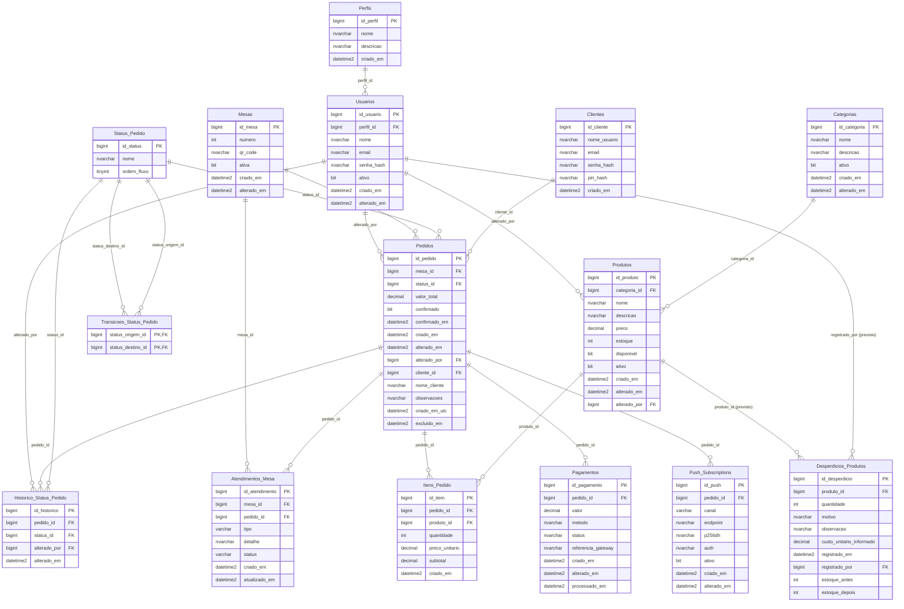

# TableHub — DER atualizado (modelo previsto) e auditoria do SQL Server

**Revisão:** outubro de 2026  
**Banco-alvo:** `Table_hub_db`, SQL Server hospedado no Somee  
**Estado:** **modelo previsto, ainda não certificado por nova exportação do Somee**.

## 1. Conclusão preliminar

O DER anterior, elaborado a partir de consultas de metadados do SQL Server e exportado para `estrutura_tablehub.csv` / `relacionamentos_tablehub.csv`, registrava **13 tabelas, 88 colunas e 17 relacionamentos por FK**. A extração é anterior às migrações de autenticação PIN e dos campos adicionais de pedidos. Portanto, não pode mais ser considerada uma documentação física atual do banco.

O modelo previsto após aplicar as migrações e a criação do módulo de desperdícios é de aproximadamente **15 tabelas, 108 colunas e até 20 relações por FK**. Esses números são derivados das mudanças versionadas e dependem de a instância real do Somee corresponder à estrutura dos scripts. A tabela de desperdícios preexistia no Somee e suas FKs/nulabilidade ainda precisam ser auditadas.

**Não existe evidência de que seja necessário rodar as migrações já aplicadas novamente.** Os testes funcionais recentes confirmaram a persistência de `Pedidos.observacoes` e `Pedidos.criado_em_utc`; outras restrições não foram verificadas neste momento.

## 2. Modificações encontradas em relação ao DER anterior

| Entidade | Mudança | Evidência e situação |
|---|---|---|
| `Clientes` | Tabela adicionada ao esquema de negócio | `sql/patch_cadastro_clientes.sql` e `sql/patch_clientes_pin.sql`; login por PIN testado |
| `Clientes.pin_hash` | Hash do PIN de quatro dígitos | Migração PIN aplicada; nunca registrar PIN sem hash |
| `Clientes.email` / `senha_hash` | Colunas legadas agora opcionais | Confirmado pela consulta feita no Somee durante os testes |
| `Pedidos.cliente_id` | FK opcional para `Clientes.id_cliente` | `sql/patch_pedidos_cliente_pin.sql` |
| `Pedidos.nome_cliente` | Nome de cliente registrado no momento do pedido | `sql/patch_pedidos_cliente_pin.sql` |
| `Pedidos.observacoes` | Instruções de preparo | `sql/patch_pedidos_observacoes_utc.sql`, testado com “carne bem passada” |
| `Pedidos.criado_em_utc` | Novo carimbo UTC para pedidos posteriores à migração | Testado com horário correto em São Paulo |
| `Desperdicios_Produtos` | Tabela de perdas por produto, usuário, quantidade e custo | Existência confirmada pelo módulo e por sua documentação; esquema físico detalhado ainda deve ser exportado |

### Relacionamentos novos ou que devem ser verificados

- `Clientes (1) → (N) Pedidos`: `Pedidos.cliente_id` pode ser `NULL` em pedidos antigos ou internos.
- `Produtos (1) → (N) Desperdicios_Produtos`: esperado pelo script de criação para bancos novos; confira FK na instância real.
- `Usuarios (1) → (N) Desperdicios_Produtos`: esperado pelo script de criação para bancos novos; confira FK na instância real.

**Atenção:** `Usuarios` são funcionários, e `Clientes` são visitantes do cardápio. São entidades distintas e não devem ser fundidas.

## 3. DER (Mermaid, editável)

Copie ou abra o bloco abaixo em Markdown com visualização de Mermaid. O mesmo modelo em DBML está no arquivo `TABLEHUB_DER_ATUALIZADO_PREVISTO.dbml` e pode ser aberto no dbdiagram.io.

## 4. Pontos de possível desatualização encontrados no repositório

1. `database/table_hub_db.sql` é um script-base histórico e não inclui por si só `Clientes`, `Desperdicios_Produtos` e as colunas novas `Pedidos.cliente_id`, `nome_cliente`, `observacoes` e `criado_em_utc`. Um banco criado somente com esse arquivo não corresponde ao ambiente atual sem os patches.
2. `estrutura_tablehub.csv` e `relacionamentos_tablehub.csv` ainda refletem a exportação de 13 tabelas/17 FKs. É necessário exportar novamente a instância Somee para obter um DER com a mesma origem verificável do primeiro.
3. `sql/patch_desperdicios_produtos.sql` declara `custo_unitario_informado DECIMAL(12,2) NOT NULL`, porém `DesperdicioService` aceita custo não informado (`NULL`), e a própria documentação do módulo considera essa possibilidade. O script novo e as regras do sistema estão divergentes. **Não execute o patch sobre a tabela existente.** Confirme o `is_nullable` real antes de ajustar o script de novos bancos.
4. A conversão para UTC foi incorporada à nova coluna de `Pedidos`, mas campos históricos como `Pedidos.criado_em`, `Pagamentos.processado_em` e os cálculos do `DashboardService` ainda dependem de convenções antigas ou do relógio do ambiente. Isso não torna o DER inválido, mas é uma observação relevante de sincronização temporal.

## 5. Como confirmar se o banco Somee está alinhado

Use o arquivo anexo `AUDITORIA_ESQUEMA_SOMEE.sql` conectado **somente ao banco do TableHub**. Todas as operações do arquivo são de leitura: `SELECT` sobre catálogos do SQL Server e declarações de tabelas variáveis locais. Nenhum dado de negócio é alterado.

**Resultados esperados:**

- `02_TABELAS`: todas as 15 tabelas como `OK` (se algum componente foi intencionalmente omitido, documentar).
- `03_COLUNAS_CRITICAS`: verificar `Clientes.pin_hash`, as quatro colunas novas de `Pedidos` e o campo `custo_unitario_informado` do desperdício.
- `04_CHAVES_ESTRANGEIRAS`: FKs de cliente e desperdício presentes e ativas, com os nomes reais registrados pelo SQL Server.
- `05_PROCEDURE`: `sp_CriarPedido` contém os parâmetros `@cliente_id`, `@nome_cliente`, `@observacoes`.
- `06_DEFAULT_UTC`: `Pedidos.criado_em_utc` possui default com `SYSUTCDATETIME()`.
- `07_CONTAGENS`: mostra os totais reais de tabelas/colunas/FKs; podem diferir do modelo previsto se houver alterações não documentadas.
- `08_EXPORTAR_COLUNAS` e `09_EXPORTAR_FKS`: exporte estes dois resultados como CSV para gerar um **DER definitivo a partir do banco**, com nulabilidade real, tipos, defaults e relações.

**Importante:** se encontrar `AUSENTE`, `TIPO_DIVERGENTE` ou `NULL_DIVERGENTE`, **não rode patches indiscriminadamente**. Primeiro compare o objeto específico com o código e faça backup antes de qualquer correção. O script de auditoria em si não precisa de backup porque só lê metadados.

## 6. Relação com o manual do usuário

O manual ilustrado já documenta o funcionamento das telas, mas o DER é um artefato de documentação **técnica do banco**, não um print de interface. Para atualizar a documentação do TCC, substitua a fotografia do DER antigo pelo diagrama gerado de uma exportação atual do Somee e indique data, banco de origem e versão do código. Até a exportação real, identifique este documento como **provisório/previsto**, não como estrutura comprovada.

### Fontes do projeto

- DER anterior: `TableHub_DER_SQL.md` (localizado na biblioteca de arquivos do projeto), produzido por metadados do SQL Server (13 tabelas / 88 colunas / 17 FKs).
- [Base SQL versionada](https://github.com/Pablo-numsei/backend2/blob/feat/customer-pin-vitrine/database/table_hub_db.sql).
- [Migração PIN](https://github.com/Pablo-numsei/backend2/blob/feat/customer-pin-vitrine/sql/patch_clientes_pin.sql).
- [Pedido vinculado ao cliente](https://github.com/Pablo-numsei/backend2/blob/feat/customer-pin-vitrine/sql/patch_pedidos_cliente_pin.sql).
- [Observações e carimbo UTC](https://github.com/Pablo-numsei/backend2/blob/feat/customer-pin-vitrine/sql/patch_pedidos_observacoes_utc.sql).
- [Script de desperdício](https://github.com/Pablo-numsei/backend2/blob/feat/customer-pin-vitrine/sql/patch_desperdicios_produtos.sql).
- [Serviço de desperdícios](https://github.com/Pablo-numsei/backend2/blob/feat/customer-pin-vitrine/src/main/java/com/itb/service/DesperdicioService.java).